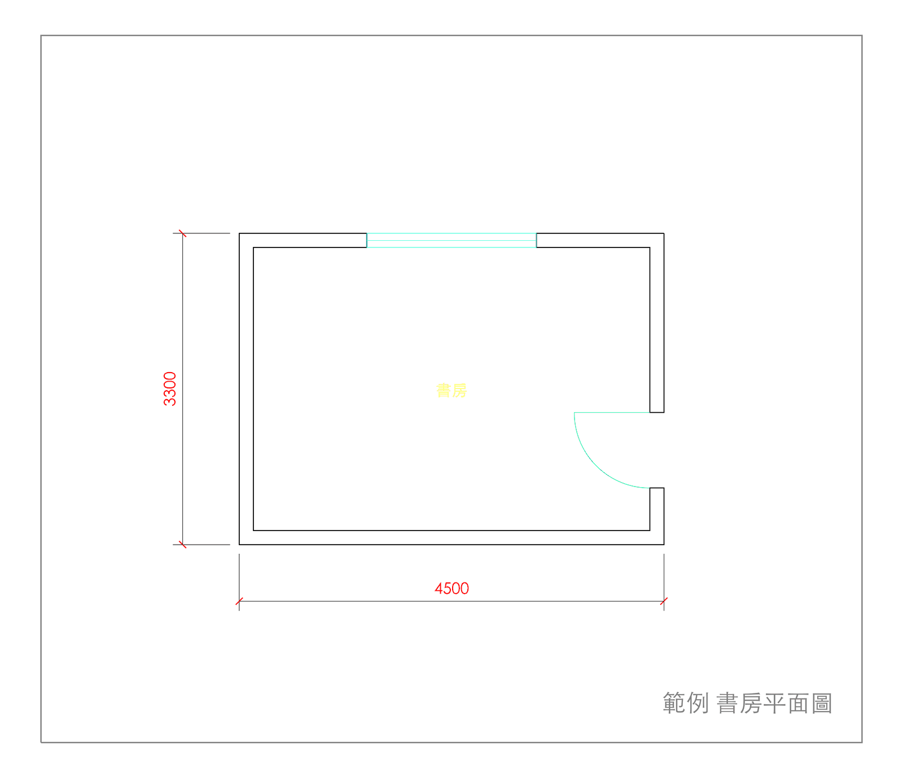
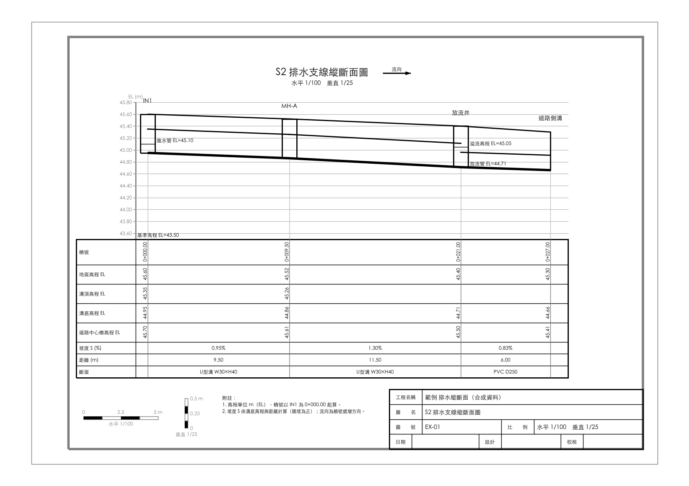
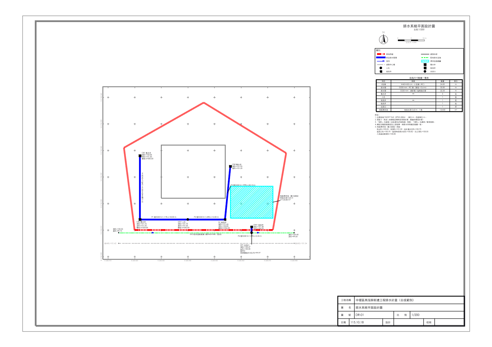
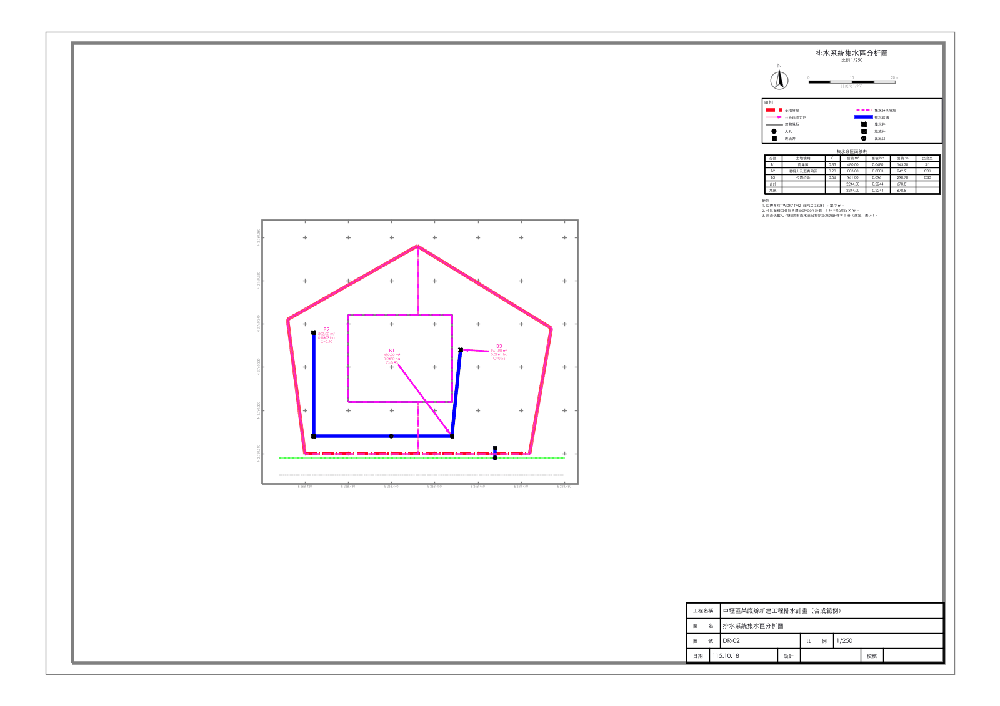
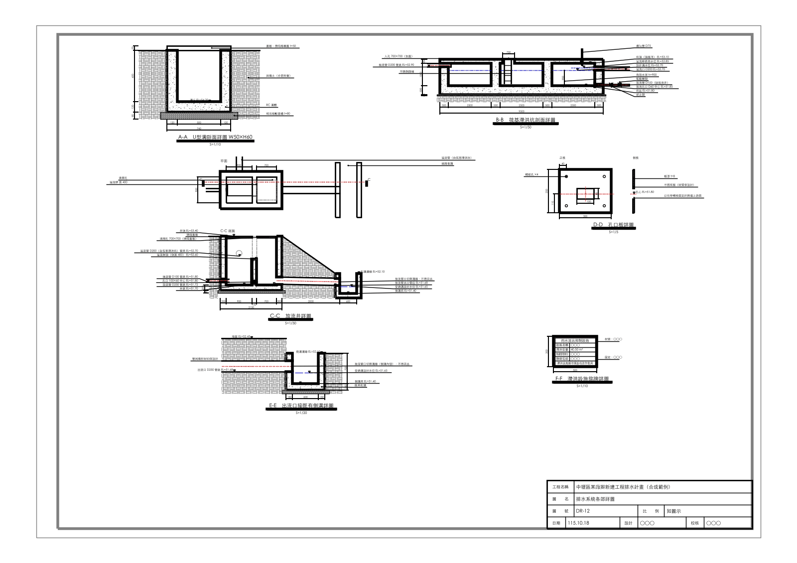
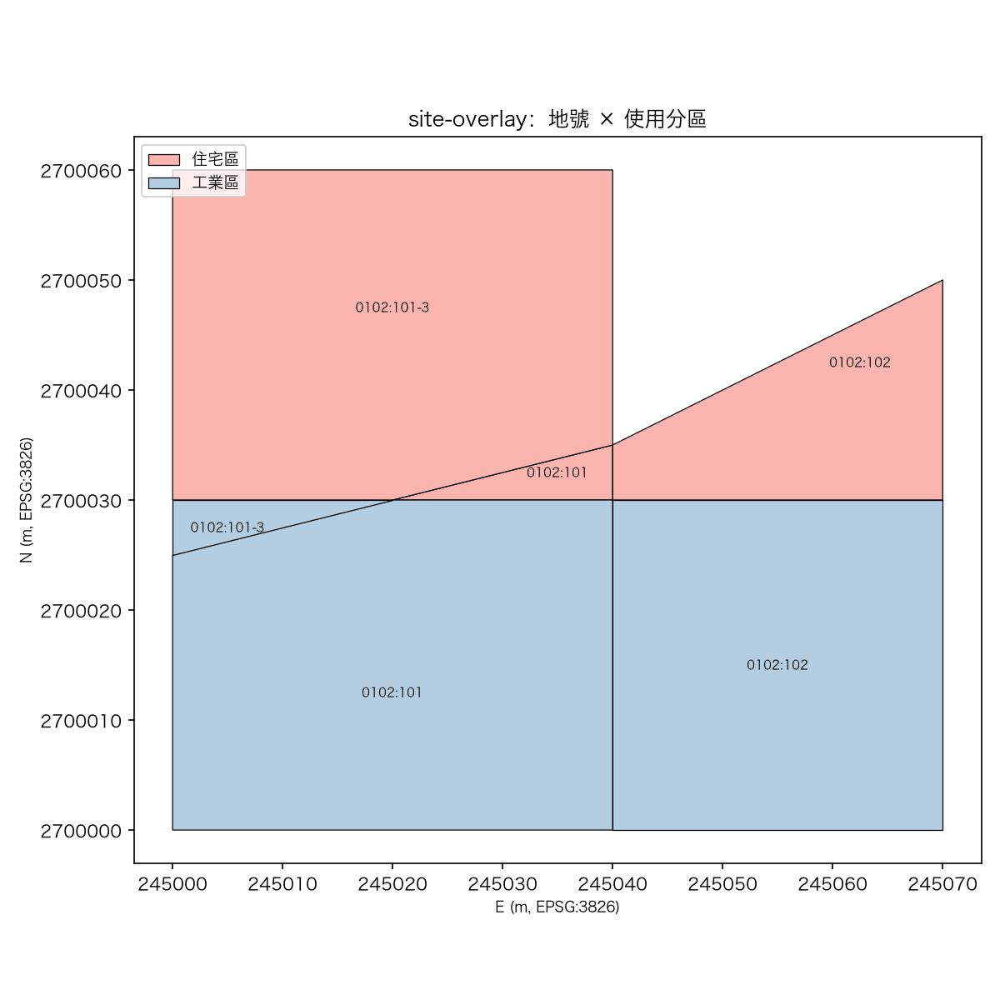
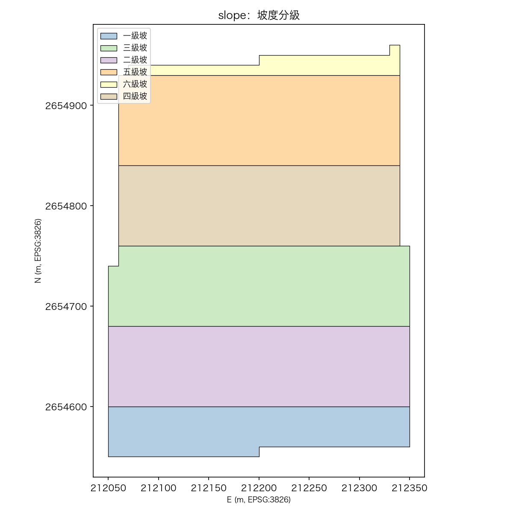

# draftagent
Agent-operable CAD drafting for Taiwan land development, urban renewal, cadastral and hydraulic planning documents

用 typed Python（或 JSON / YAML）寫 spec → `draftagent build` 一次完成產圖與全部 verifier，產物與 spec.json 自動存到 `runs/`。

```bash
uv venv && uv pip install -e ".[dev]"     # 安裝後 .venv/bin/draftagent 可用（Windows 見下方「Windows 安裝」）
draftagent check                           # 環境自檢（套件、CJK 字型、選用相依）
draftagent kinds                           # 有哪些圖種
draftagent new plan -o work/plan.py        # 產生可執行的 Python 範例 spec，照需求修改
draftagent build work/plan.py              # render → verifier → runs/<ts>-plan-…/
open runs/*-plan*/plan.png                 # 看預覽；verifier 完整輸出在 verify.txt
```

```python
from draftagent import build, PlanSpec, Room, Rect
print(build(PlanSpec(wall_thickness=200, rooms=[Room(name="房間", rect=Rect(width=6000, depth=4000))])))
```

| 圖種 | Spec | 產出 | 單位 |
|---|---|---|---|
| `plan` | `PlanSpec` | 建築平面圖 DXF + PNG | mm |
| `drainage-profile` | `ProfileSpec` | 排水縱斷面圖 DXF（含圖框圖簽）+ PNG | 圖紙 mm |
| `drainage-detail` | `DetailSheetSpec` | 排水系統各部詳圖 DXF（U 溝 / 筏基滯洪 / 放流井 / 孔口板 / 出水口 / 銘牌） | 圖紙 mm |
| `drainage-plan` | `DrainageNetworkSpec` | 整套排水圖：平面設計圖 + 集水區分析圖 + 主幹 / 出水側縱斷面 + 詳圖 + 流出抑制計算（同一模型、跨圖一致性檢查） | m（TWD97） |
| `drainage-calc-ty` | `TaoyuanSiteDrainageSpec` | 桃園流出抑制計算 result.json + 計算表 md | m / m² |
| `outflow-control` | `OutflowControlSpec` | 出流管制水文水理 result.json + 附圖 16/18/19 + SWMM inp | m / m³/s |
| `site-overlay` | `SiteSpec` | 地號 × 分區套疊 GeoPackage + 面積表 | m（EPSG:3826） |
| `slope` | `SlopeSpec` | 坡度分級 GeoTIFF / GPKG / CSV | m（EPSG:3826） |

欄位查詢：`draftagent schema <kind>`。Agent 作業規則見 [CLAUDE.md](CLAUDE.md)，完整計畫見 [docs/PLAN.md](docs/PLAN.md)、開發方式見 [docs/DEVELOPMENT.md](docs/DEVELOPMENT.md)。
每個圖種跑哪些 verifier、檢查什麼與已知限制見 [docs/VERIFIERS.md](docs/VERIFIERS.md)；agent 評估方式見 [docs/EVAL.md](docs/EVAL.md)。
綠燈只代表「通過本 repo 現有 verifier 的檢查項目」，不代表符合法規。

## Windows 安裝

同事端以 Windows（AutoCAD / BricsCAD）為主；以下在 PowerShell 執行：

```powershell
powershell -ExecutionPolicy ByPass -c "irm https://astral.sh/uv/install.ps1 | iex"   # 安裝 uv（裝完重開 PowerShell）
uv venv
.venv\Scripts\activate                         # 若被執行原則擋下：Set-ExecutionPolicy -Scope CurrentUser RemoteSigned
uv pip install -e ".[dev,ifc,report]"
draftagent check                               # 環境自檢
draftagent kinds
draftagent build examples\plan.json            # 產物在 runs\<ts>-plan-…\
```

- 不 activate 時，Mac / Linux 的 `.venv/bin/draftagent`、`.venv/bin/python` 對應 `.venv\Scripts\draftagent.exe`、`.venv\Scripts\python.exe`。
- DXF 中文字型預設 `msjh.ttc`（微軟正黑體，Windows 內建），AutoCAD / BricsCAD 開圖即可顯示；要改用其他字型設環境變數
  `$env:DRAFTAGENT_CAD_FONT = "NotoSansTC-Regular.ttf"`。
- DWG 轉檔（`draftagent convert-dwg`）建議安裝 [ODA File Converter](https://www.opendesign.com/guestfiles/oda_file_converter)
  （需同意其使用條款）；會自動在 `C:\Program Files\ODA\ODAFileConverter <版本>\` 找到。也可請建築師直接「另存 DXF」。
- console 輸出（🟢🔴、中文）在 Windows 會自動切成 UTF-8；若在舊版 cmd 看到亂碼，先執行 `chcp 65001`。
- git clone 時 `AGENTS.md` 是指向 `CLAUDE.md` 的 symlink；Windows 未開 `core.symlinks` 時它會變成只含檔名的文字檔，內容以 `CLAUDE.md` 為準。

## 評估結果

2026-10-18 以 Opus 5.5 / Sonnet 5.5 / Haiku 5.5 跑 18 題（Level 1–3），最新有效結果 70/72 pass；15 次非 pass 中 14 次是題目、harness 或評分的問題，只有 1 次（Haiku 10 房配置）是模型能力。矩陣、失敗根因與出題原則見 [docs/RESULTS.md](docs/RESULTS.md)。

## 圖庫

由 `examples/*.json` build 出的預覽（全部為合成範例資料；重新產生：`.venv/bin/python scripts/make_gallery.py`）。

| | |
|---|---|
| **plan** 建築平面圖<br>[](docs/gallery/plan.png) | **drainage-profile** 排水縱斷面圖<br>[](docs/gallery/drainage-profile.png) |
| **drainage-plan** 平面設計圖<br>[](docs/gallery/drainage-plan-design.png) | **drainage-plan** 集水區分析圖<br>[](docs/gallery/drainage-plan-catchment.png) |
| **drainage-detail** 排水系統各部詳圖<br>[](docs/gallery/drainage-detail.png) | **site-overlay** 地號 × 使用分區（GeoPackage）<br>[](docs/gallery/site-overlay.png) |
| **slope** 坡度分級（GeoPackage）<br>[](docs/gallery/slope.png) | |
